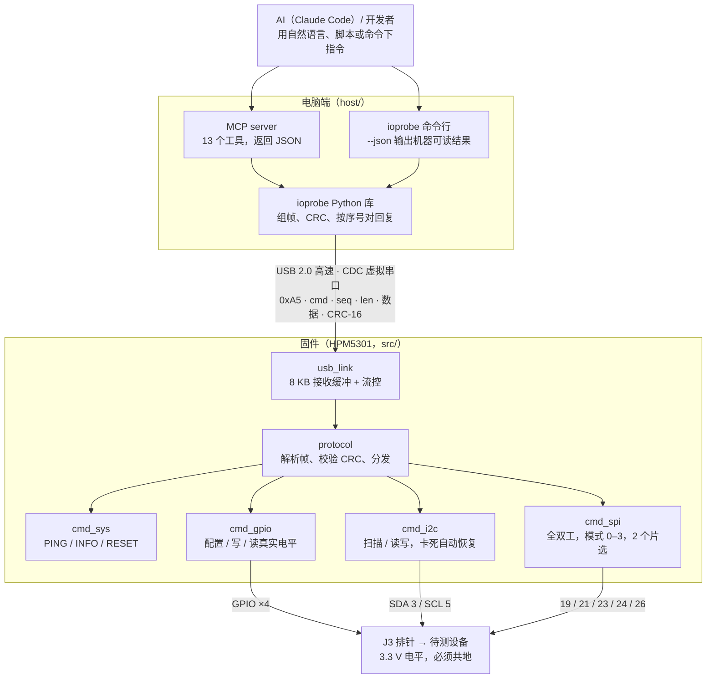

# HPM5301 IO Probe 规格书

2026-10-20 · 固件 0.6.0 · 协议 v1 · 电脑端库 ioprobe 0.4.0

IO Probe 基于 HPM5301EVKLite 开发板，用一根 USB 线让电脑和 AI 收发 I2C、SPI 和 GPIO 信号，同时充当待测 MCU 的 DAPLink（SWD）调试器和串口。

在线协作版本：[Claude Docs 规格书](https://claude.ai/code/artifact/8a539ee3-7bf5-4c6e-9dc7-dcd737f66496)。引脚细节见 [pinout.md](pinout.md)；待测试项目和已知问题见 [quality.md](quality.md)。

## 1. 功能配置

当前版本提供 1 路 I2C 主机、1 路 SPI 主机（2 个片选）、4 个 GPIO、SWD 调试口和目标串口，全部从 J3 排针（树莓派兼容 40 针）引出，IO 电平都是 3.3 V。

| 功能 | 数量 | 片上外设 | J3 引脚 | 可配置项 | 状态 |
| --- | --- | --- | --- | --- | --- |
| I2C 主机 | 1 路 | I2C2 | SDA 3，SCL 5 | 速率 100 k / 400 k / 1 MHz | 已实现 |
| SPI 主机 | 1 路，2 个片选 | SPI1 | MOSI 19，MISO 21，SCLK 23，CS0 24，CS1 26 | 模式 0–3、频率、MSB/LSB 先发、片选保持 | 已实现 |
| GPIO | 4 个 | GPIO0 | 11，27，31，32 | 输入 / 推挽输出 / 开漏，上拉 / 下拉 / 无 | 已实现（J3-37 不可用，已去掉） |
| DAPLink 调试器 | 1 路 SWD | SPI2 | SWCLK 13，SWDIO 28，nRESET 29，GND 30 | CMSIS-DAP v2；SWD 时钟由调试软件设置（推荐 8–40 MHz） | 已实现，STM32G0B1 实测通过 |
| 目标串口 | 1 路 | UART3 | TX 8，RX 10 | 波特率 / 数据位 / 校验 / 停止位跟随电脑端 | 已实现，待回环实测 |
| 调试串口 | 1 路 | UART0 | TX 36，RX 38 | 115200 bps，固件日志 | 保留，不对外开放 |
| I2C 从机模拟 | 复用 I2C 主机那一路 | I2C2 | SDA 3，SCL 5 | 由命令切换主/从 | 后续 |
| SPI 从机模拟 | 复用 SPI 主机那一路 | SPI1 | 19 / 21 / 23 / 24 | 由命令切换主/从 | 后续 |

**J3 引脚分配**

| J3 | 芯片脚 | 分配 | 备注 |
| --- | --- | --- | --- |
| 1, 17 | — | 3.3 V 电源 | |
| 2, 4 | — | 5 V 电源 | 不要接到 IO |
| 3 / 5 | PB09 / PB08 | I2C SDA / SCL | 外接设备需要 4.7 kΩ 上拉到 3.3 V |
| 8 / 10 | PB15 / PB14 | 目标串口 TX / RX | TX 接目标板 RX，RX 接目标板 TX |
| 11 | PA31 | GPIO | |
| 13 | PB11 | SWCLK | DAPLink，SPI2_SCLK；旁边 14 是 GND |
| 19 / 21 / 23 | PA29 / PA28 / PA27 | SPI MOSI / MISO / SCLK | |
| 24 / 26 | PA26 / PB10 | SPI CS0 / CS1 | 低电平有效，固件用 GPIO 控制 |
| 27 | PB12 | GPIO | |
| 28 | PB13 | SWDIO | DAPLink，SPI2_MOSI 双向模式 |
| 29 | PY00 | nRESET | DAPLink，开漏；丝印 USB_ID，板上有上拉 |
| 31 | PY01 | GPIO | 丝印 USB_OC，板上有上拉，悬空读到 1 |
| 32 | PA09 | GPIO | |
| 33 | PA10 | 板载 LED（心跳） | 不对外开放 |
| 36 / 38 | PA00 / PA01 | 调试串口 TX / RX | 保留 |
| 37 | PA30 | 不使用 | 丝印 USB0_PWR，接 J1 的 VBUS 供电控制，不要驱动（0.2.1 起去掉） |
| 6, 9, 14, 20, 25, 30, 34, 39 | — | GND | |
| 7 | 待核实 | 未分配 | 手册和丝印都写 PB15，但 J3-8 也是 PB15；需量 J3-7 与 J3-8 是否导通 |
| 12, 15, 16, 18, 22, 35, 40 | — | 空脚（NC） | |

## 2. 整机参数

整机由 USB Type-C 供电并通信，电脑端免驱动。小命令往返约 0.09 ms，大块数据往返约 9 MiB/s，一次最多传 4096 字节。

| 类别 | 参数 | 数值 | 来源 |
| --- | --- | --- | --- |
| 硬件平台 | 开发板 | HPM5301EVKLite RevB | 板丝印 |
| 主控 | 芯片 | 先楫 HPM5301（HPM5301xEGx），32 位 RISC-V | SDK |
| 主控 | 存储 | Flash 1 MB；ILM 128 KB，DLM 127 KB，AHB SRAM 32 KB | 链接脚本 |
| 通信 | 与电脑的接口 | USB 2.0 高速 480 Mbit/s，复合设备：CMSIS-DAP v2 + 2 个 CDC-ACM 虚拟串口 | 实测（macOS） |
| 通信 | USB 标识 | VID 0x34B7，PID 0x5301，产品名 “IO Probe CMSIS-DAP”，序列号 “IOPROBE-” + 16 位十六进制（由芯片 OTP UUID 生成，每块板不同） | 固件 |
| 通信 | 驱动 | macOS / Linux 免驱；Windows 通过 WinUSB（MS OS 2.0 描述符）免驱 | 实测 macOS；Windows 未测 |
| 调试器 | 协议 | CMSIS-DAP v2.1（固件报告 2.1.1），仅 SWD，包长 1024 B × 8（OpenOCD 0.12 能安全使用的上限） | OpenOCD 0.12 实测识别 |
| 调试器 | 支持的软件 | OpenOCD、pyOCD、probe-rs、Keil 等支持 CMSIS-DAP v2 的工具 | 协议标准 |
| 目标串口 | 参数 | 波特率 / 数据位 7–8 / 奇偶校验 / 停止位 1–2，跟随电脑端设置；收发各 4 KB 缓冲 | 固件 |
| 电气 | 供电 | USB Type-C 5 V（≤ 5.5 V），J1 或 J2 | 用户手册 |
| 电气 | USB 线材 | 必须插 J1；用 A-to-C 线，或在 USB-C 口加“C 转 A”转接头。C-to-C 线接 USB-C 主机口不上电、不识别（J1 缺 CC 下拉） | 实测 |
| 电气 | IO 电平 | 3.3 V，无电平转换、无保护；不得接 5 V 信号，待测设备必须共地 | 芯片规格 |
| 协议 | 帧格式 | SOF(0xA5) · cmd · seq · len(16 位) · payload · CRC-16/CCITT-FALSE | src/protocol.h |
| 协议 | 单帧容量 | 请求数据 ≤ 4096 字节；回复数据 ≤ 4095 字节（另有 1 字节状态码） | 实测 |
| 性能 | 小命令往返 | 中位数约 86 µs，p95 约 96 µs（gpio_read） | 实测（0.4.0） |
| 性能 | 大数据往返 | 4095 字节回显 1176 次/s，双向合计约 9.4 MiB/s | 实测（0.4.0） |
| 性能 | SPI 传输 | 4093 字节一帧，有效数据约 2.3 MiB/s（SCLK 设 40 MHz） | 实测（0.4.0） |
| 性能 | I2C 全地址扫描 | 约 105 ms（0x08–0x77，空总线） | 实测 |
| 性能 | SWD 读 Flash（STM32G0B1） | 8 MHz 288 KiB/s，16 MHz 494 KiB/s，24 MHz 635 KiB/s，32 MHz 765 KiB/s，40 MHz 841 KiB/s（256 KB 整片读，逐字节核对） | 实测（0.6.0） |
| 性能 | SWD 编程 Flash（STM32G0B1） | 256 KB 擦除 + 编程 + 校验约 6.5–6.7 s，各档时钟都一样：瓶颈是 G0 自身的擦写时间（约 5–6 s） | 实测（0.6.0） |
| 性能 | 复位后重新可用 | 约 1 s（USB 重新枚举） | 实测（0.1.0） |
| 版本 | 固件 / 协议 / 电脑端库 | 0.6.0 / v1 / ioprobe 0.4.0 | 代码 |

待确认：主频、SPI 最高 SCLK、SWD 实际 SWCLK 频率、整机功耗和尺寸尚未实测；SPI 和目标串口的数据还未用回环线验证。

## 3. 组件参数

整机由开发板硬件、板上固件和电脑端软件三部分组成，各组件参数如下。

**硬件组件**

| 组件 | 型号 / 位号 | 关键参数 | 在 IO Probe 中的用途 |
| --- | --- | --- | --- |
| 主控 MCU | HPM5301（U4） | RISC-V；4×I2C、4×SPI（主/从）；片内 USB 2.0 高速 PHY | 协议处理，驱动全部 IO |
| USB 接口 | Type-C J1（USB0）；Type-C J2（仅供电） | USB 2.0 高速设备；两个口都缺 CC 下拉电阻 | J1：供电 + 与电脑通信；J2：只供电 |
| 扩展排针 | J3，2×20，2.54 mm | 树莓派兼容排列 | 引出 I2C / SPI / GPIO / SWD / 目标串口 |
| 调试接口 | J5，标准 20 针 JTAG | J-Link 等调试器 | 烧录、调试 IO Probe 自身固件（`flash.sh`） |
| 按键 | SW1 RESET；SW2 KEY&BOOT | 按住 KEY 再复位进入 ISP | 复位 / 进入烧录模式 |
| 指示灯 | LED（PA10） | 低电平点亮 | 心跳，每 500 ms 翻转一次 |

**固件模块**（工程 `src/`，`-O3` 编译，占用 Flash 约 90 KB）

| 模块 | 文件 | 职责 | 关键参数 |
| --- | --- | --- | --- |
| USB 链路 | usb_link.c | 复合设备描述符（DAP + 2×CDC + WinUSB），IO Probe 控制口收发（CherryUSB） | 接收环形缓冲 8 KB，缓冲满时自动流控；发送缓冲 4352 B |
| DAP 传输 | dap_link.c | CMSIS-DAP v2 bulk 请求/回复队列 | 1024 B × 8 包 |
| DAP 配置 | dap/DAP_config.h | SWD 引脚（J3-13/28/29）、包长、仅 SWD | 默认 1 MHz |
| SWD | dap/sw_dp_spi.c | SWD 时序由 SPI2 产生（移植自 CherryDAP SW_DP_SPI，BSD-3） | SPI 模式 0、LSB 先发、MOSI 双向；跳过 23.5–25.5 MHz |
| DAP 核心 | third_party/cherrydap | CMSIS-DAP 命令处理（ARM / CherryDAP，Apache-2.0） | 固定在 CherryDAP 43d2b4c |
| 目标串口 | target_uart.c | CDC #2 ↔ UART3 转发 | 中断接收 + 轮询发送，各 4 KB 缓冲 |
| 协议 | protocol.c | 帧解析、CRC 校验、命令分发 | 遇到乱码自动重新同步到下一个 0xA5 |
| 引脚表 | pins.c | J3 编号 → 芯片脚 | 上电时全部 GPIO 设为输入 + 下拉（安全态） |
| 系统命令 | cmd_sys.c | PING / GET_INFO / RESET | 复位前留 20 ms 让回复发出 |
| GPIO | cmd_gpio.c | 配置 / 写 / 读 | 打开回环读取：输出状态下读到的是引脚真实电平 |
| I2C | cmd_i2c.c | 主机读写、扫描 | 总线卡死 / 超时后自动释放总线并重新初始化 |
| SPI | cmd_spi.c | 全双工传输、片选控制 | 默认模式 0、1 MHz、MSB 先发 |

**电脑端软件**（工程 `host/`，Python ≥ 3.9）

| 组件 | 入口 | 用途 | 依赖 |
| --- | --- | --- | --- |
| Python 库 | `ioprobe.Probe`、`find_target_uart()` | 在脚本里调用 probe；自动区分控制口和目标串口 | pyserial ≥ 3.5 |
| 命令行 | `ioprobe` | 人工调试；加 `--json` 输出机器可读结果 | 同上 |
| MCP server | `ioprobe-mcp`（在 `.mcp.json` 中注册） | 让 AI 直接调用 13 个工具 | mcp 2.3.x |
| 测试 | pytest | 64 个离线测试，另有硬件测试（`--hardware`） | pytest ≥ 7 |

**性能优化记录（固件 0.4.0）**

同一块板、同一台 Mac 上实测，三列分别是：优化前、只改成 `-O3`、加上全部改动。

| 指标 | 0.3.0（-O0） | 只改 -O3 | 0.4.0 |
| --- | --- | --- | --- |
| 小命令往返（中位数） | 90 µs | 86 µs | 86 µs |
| 64 B 回显 | 4222 次/s | 5338 次/s | 11079 次/s |
| 512 B 回显（双向） | 658 KiB/s | 1079 KiB/s | 5520 KiB/s |
| 4095 B 回显（双向） | 802 KiB/s | 1685 KiB/s | 9407 KiB/s |
| SPI 4093 B（有效数据） | 318 KiB/s | 725 KiB/s | 2348 KiB/s |
| SWD 读 Flash（8 MHz） | 160 KiB/s | 260 KiB/s | 261 KiB/s |
| SWD 编程 256 KB + 校验 | 约 9 s | 约 7 s | 约 6.5 s |

改动内容：
- **默认 `-O3`**：SDK 把 `CMAKE_BUILD_TYPE=flash_xip` 当成 debug（`-O0`）编译。现在 `CMakeLists.txt` 默认 `HPM_BUILD_TYPE=flash_xip` 加 `CMAKE_BUILD_TYPE=release`；调试时加 `-DCMAKE_BUILD_TYPE=debug`。
- **固件数据通路**：CRC-16 改为查表；环形缓冲和帧接收改用 `memcpy`，不再逐字节处理。
- **电脑端 CRC**：改用 C 实现的 `binascii.crc_hqx`。原来的纯 Python 逐位计算，每次 4 KB 往返要多花约 10 ms，是大块传输的主要瓶颈。
- **USB 序列号**：由芯片 OTP UUID 生成，多块 probe 同时接也不会冲突。
- **DAP 包队列**：从 4 个加到 8 个。

小命令延迟基本由 USB 帧周期和主机调度决定，固件优化影响不大。

**SPI 加速 SWD（固件 0.5.0 引入，0.6.0 起是唯一方式）**

STM32G0B1 读 Flash（64 KB，OpenOCD 0.12 `dump_image`），每次都和备份逐字节比对：

| SWD 设定时钟 | 0.4.0 位操作，512 B 包 | 0.5.0 SPI，512 B 包 | 0.5.0 位操作，1024 B 包 | 0.5.0 SPI，1024 B 包 |
| --- | --- | --- | --- | --- |
| 8 MHz | 261 KiB/s | 209 KiB/s | 552 KiB/s | 287 KiB/s |
| 16 MHz | 262 KiB/s | 260 KiB/s | 551 KiB/s | 492 KiB/s |
| 24 MHz | — | 260 KiB/s | 连不上 | 648 KiB/s |
| 32 MHz | 连不上 | 260 KiB/s | 连不上 | **763 KiB/s** |

结论：
- **512 B 包时 SPI 没有提速**：两种后端都卡在约 260 KiB/s，瓶颈是每个 DAP 包的 USB 往返，不是 SWD 时钟。
- **包长加到 1024 B 后**，每个往返能带 255 个字，SPI 的速度开始随时钟上升，32 MHz 时达到 0.4.0 的 2.9 倍；位操作在约 550 KiB/s 封顶，24 MHz 起连不上。
- **2048 B 包不能用**：`DAP_Transfer` 的回复计数只有 1 个字节（最多 255），OpenOCD 0.12 会往一个包里塞超过 255 个传输，报 `transfer count mismatch`。
- **编程速度不变**（约 6.5 s / 256 KB）：G0 的 Flash 擦写本身就要 5–6 s，探针再快也省不了多少；提速主要体现在读取、校验、下载到 RAM，以及 Flash 更快的目标芯片上。
- **位操作的时钟不准**：同样设定 8 MHz，位操作比 SPI 快约一倍，说明 `CPU_CLOCK` 标定值偏低、实际 SWCLK 高于设定值。SPI 模式的时钟和设定值一致。
- **0.6.0 只保留 SPI**：SPI 在高时钟下更稳（位操作 24 MHz 起连不上），位操作代码和 `swd-mode` 命令已删除。
- **24–25 MHz 的 SWCLK 不稳定**：实际 SWCLK 正好是 24.0 或 25.0 MHz 时，10 次连接失败 8 次；23.2 MHz 和 25.7–48 MHz 都稳定。原因没查明（需要示波器），固件选分频时跳过 23.5–25.5 MHz。改完后 8–40 MHz 每档 5 次连接全部成功。
- **建议**：OpenOCD `adapter speed` 用 8000–40000；长杜邦线或信号不稳时降到 8000–16000。

## 4. 功能说明

每条指令都走同一条链路：AI 或脚本 → 电脑端库 → USB 协议帧 → 固件 → J3 引脚；回复带状态码沿原路返回。

MCP server 和命令行都只是 ioprobe 库的外壳，因此 AI、脚本和人工操作得到的结果完全一致。

**命令一览**

| 类别 | 命令（代码） | 参数 | 返回 | MCP 工具 |
| --- | --- | --- | --- | --- |
| 系统 | PING（0x01） | 任意字节 | 原样回显 | — |
| 系统 | GET_INFO（0x02） | 无 | 协议版本、固件版本、最大载荷、GPIO 引脚表 | probe_info |
| 系统 | RESET（0x03） | 无 | 先应答再复位，约 1 s 后可用 | probe_reset |
| GPIO | GPIO_CONFIG（0x10） | 引脚、模式（输入 / 推挽 / 开漏）、上下拉、初始电平 | — | gpio_config |
| GPIO | GPIO_WRITE（0x11） | 引脚、电平 | — | gpio_write |
| GPIO | GPIO_READ（0x12） | 引脚 | 引脚真实电平 | gpio_read（带 pin） |
| GPIO | GPIO_READ_ALL（0x13） | 无 | 每个 GPIO 的引脚和电平 | gpio_read（不带 pin） |
| I2C | I2C_CONFIG（0x20） | 总线、速率 | — | i2c_config |
| I2C | I2C_SCAN（0x21） | 总线 | 应答的地址列表 | i2c_scan |
| I2C | I2C_WRITE（0x22） | 总线、地址、数据 | — | i2c_write |
| I2C | I2C_READ（0x23） | 总线、地址、长度 | 数据 | i2c_read |
| I2C | I2C_WRITE_READ（0x24） | 总线、地址、读长度、写数据 | 数据（重复起始，即寄存器读） | i2c_write_read |
| SPI | SPI_CONFIG（0x30） | 总线、模式、位序、频率 | — | spi_config |
| SPI | SPI_TRANSFER（0x31） | 总线、片选（0 / 1 / 不控制）、是否保持片选、数据 | 同长度的接收数据 | spi_transfer |
| SPI | SPI_CS（0x32） | 总线、片选、拉低 / 释放 | — | spi_cs |

**使用约定**

- 引脚用 J3 编号；I2C 地址为 7 位；数据字节用十六进制。
- 上电默认：GPIO 为输入 + 下拉；I2C 100 kHz；SPI 模式 0、1 MHz、MSB 先发，片选释放（高电平）。
- 电脑端等待回复 2 s；回复按序号匹配，过期回复自动丢弃。
- MCP 工具返回 ok、error、detail 和 elapsed_ms；USB 断开或超时后，下一次调用自动重连。

**典型测试流程**

1. probe_info：确认固件版本和可用引脚。
2. 配置接口：i2c_config / spi_config / gpio_config。
3. 找到待测设备：i2c_scan，或用 spi_transfer 读芯片 ID。
4. 收发数据，按状态码和返回数据判断待测设备是否合理（见第 5 节）。

**DAPLink 与目标串口**（固件 0.2.0 起；SWD 已在 STM32G0B1 上实测连接、复位、读写和 Flash 编程，详见 pinout.md）

同一个 USB 设备里还有两个功能，不走上面的协议，也不占用 MCP 工具：用标准调试软件和串口工具就能使用。上面的架构图只画了 IO Probe 控制链路。

| 功能 | 电脑上看到的 | 接线（J3） | 典型用法 |
| --- | --- | --- | --- |
| DAPLink（SWD） | CMSIS-DAP v2 调试器 | SWCLK 13，SWDIO 28，nRESET 29，GND 30 | OpenOCD / pyOCD / probe-rs 给 3.3 V ARM Cortex-M 烧录、调试 |
| 目标串口 | 第二个 USB 串口（第一个是 IO Probe 控制口） | TX 8 → 目标 RX，RX 10 ← 目标 TX，GND | 看目标板日志、和目标固件交互 |

合起来就是一个完整的闭环：AI 用 DAPLink 烧录待测固件，用目标串口看它的输出，用 I2C / SPI / GPIO 给它激励并观察响应。三个功能在固件主循环里轮流处理，互不阻塞。

## 5. 故障代码

每条回复的第 1 个字节是状态码，0 表示成功。码 1–8 由固件返回；TIMEOUT 和 NOT_CONNECTED 还可能由电脑端自己产生。Python 库把非 0 状态抛成 `ProbeError`（`.status`）；MCP 工具返回 `ok=false` 和 `error` 字段。

| 代码 | 名称 | 来源 | 含义 | 常见原因 | 处理方法 |
| --- | --- | --- | --- | --- | --- |
| 0 | OK | 固件 | 成功 | — | — |
| 1 | BAD_CRC | 固件 | 请求帧 CRC 校验失败 | 串口数据损坏；电脑端协议版本不一致 | 重发；核对协议版本（GET_INFO） |
| 2 | UNKNOWN_CMD | 固件 | 命令字不存在 | 电脑端比固件新 | 升级固件或改用已支持的命令 |
| 3 | BAD_ARG | 固件 / 电脑端 | 参数不合法 | 引脚不在 GPIO 列表、地址超过 7 位、长度为 0、SPI 频率无法配置、十六进制写错 | 按规格修正参数；用 probe_info 查可用引脚 |
| 4 | NACK | 固件 | I2C 地址或数据没有应答 | 该地址无设备、地址写错、设备未上电、没有上拉电阻 | 先 i2c_scan 确认地址；检查供电和 4.7 kΩ 上拉 |
| 5 | TIMEOUT | 固件 / 电脑端 | 操作或回复超时 | 固件：I2C 时钟被从机拉低；电脑端：2 s 内无回复（USB 断开、固件未运行） | 固件已自动恢复总线，可直接重试；MCP 会在下次调用时自动重连 |
| 6 | BUS_BUSY | 固件 | I2C 总线被占用 | SDA 被拉低、总线上有其他主机、上次传输中断 | 固件已发时钟释放总线并重新初始化，重试；仍失败则检查接线 |
| 7 | IO_ERROR | 固件 | 外设返回其他错误 | 控制器异常、SPI 传输失败 | 重试；仍失败则用 probe_reset 复位 |
| 8 | TOO_LONG | 固件 | 数据超过单帧容量 | 请求 > 4096 字节，或回复需要 > 4095 字节 | 拆成多次传输（SPI 用 keep_cs 保持片选） |
| — | NOT_CONNECTED | 电脑端 | 找不到或打不开 probe | USB 未连接、接了多个 probe、串口被其他程序占用 | 连接 USB；用 `ioprobe list` 查看；关闭占用串口的程序 |

硬件层面的异常不会报错，只能从读数判断：GPIO 设为输出后读回的电平和写入不一致，说明引脚短路或和外部电路冲突。DAPLink 的错误由调试软件报告（例如 OpenOCD 在未接目标板时报 `Error connecting DP: cannot read IDR`）。
